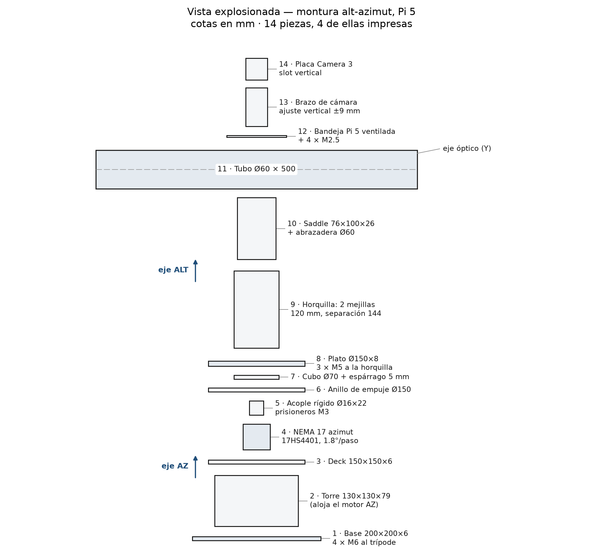
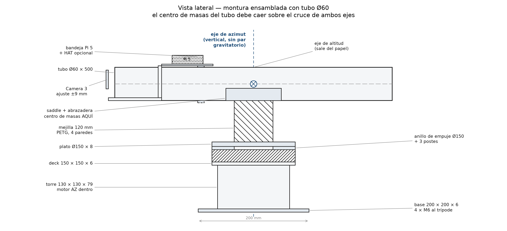

**Abstract—**Small robotic telescopes have become affordable, yet autonomous pointing remains gated by computation: plate solving is still performed on a host computer or in the cloud, while the mount itself carries no perception. This paper proposes and evaluates a reference architecture in which a Raspberry Pi 5 performs plate solving locally, closing the control loop over two NEMA 17 steppers driven by A4988 modules, and compares three inference back-ends under identical optical and mechanical conditions: the Pi 5 CPU, a Hailo-8L accelerator (13 TOPS), and an AWS Lambda function. A quantized INT8 solver derived from MobileNetV3-Small and a distilled transformer is characterized not by classification accuracy but by its effect on pointing error in arcminutes, together with latency (p50/p95), energy per observing session (Wh), and cost per thousand inferences (USD). The experimental design comprises 90 episodes across three conditions and thirty repetitions, benchmarked against a commercial GoTo mount. Expected outcomes are a reproducible reference design, an open dataset of night-sky captures with ground-truth astrometry, and the first head-to-head evidence on when an accelerator is worth its cost in a scientific instrument. The study targets instrumentation venues and provides the measurement methodology that the edge-AI literature currently lacks for astronomy.

**Index Terms—**Edge AI, plate solving, embedded systems, Raspberry Pi 5, Hailo-8L, telescope pointing, quantization, cloud inference, astronomical instrumentation.

# I. Introduction

Backyard astronomy has been quietly industrialised. Cameras that once cost a month of salary are now sensors on a board, mounts that once required machining are now commodity steppers and aluminium extrusions, and the software stack that used to demand a workstation runs on a single-board computer. The consequence is that a motivated amateur can assemble, for a few hundred dollars, an instrument that images objects a professional observatory catalogued only a generation ago. What has not been democratised is autonomy: the ability of that instrument to find its own target, verify that it is pointing where it believes, and correct itself without a human at the eyepiece.

The enabling technology for that autonomy is plate solving, the process of recovering the pointing, scale, and orientation of an image by matching detected stars against a catalogue. The classical formulation, Astrometry.net, is robust and blind, and remains the reference against which every subsequent solver is measured [1]. It is also computationally heavy by embedded standards, and it produces a solution only after the exposure has been taken, downloaded to a host, and processed. In practice this means the perception loop lives on a laptop, and the mount remains an open-loop machine executing a precomputed slew.

Simultaneously, a different community has spent the same decade making inference cheap. Quantization to INT8, operator fusion, and dedicated neural accelerators have moved convolutional networks from data-centre GPUs onto devices drawing a few watts [22], [23]. The Hailo-8L is representative: thirteen TOPS in a module that sits on a Raspberry Pi HAT and is marketed explicitly for vision workloads on single-board computers. Benchmarks in adjacent domains report order-of-magnitude throughput gains over CPU inference [19], [20], [21]. It is tempting to assume the gain transfers to astronomy.

It does not transfer automatically. The edge-AI benchmarking literature measures object detection and classification, where a small change in intersection-over-union is tolerable. Astronomical pointing is a regression problem with a hard physical interpretation: a solver error of half a degree means the target is outside the field of view, and a quantization artefact that shifts a centroid by one pixel propagates into arcminutes of pointing error. No study we identified reports that propagation. The edge-AI literature reports what a model predicts; the instrumentation literature reports what an instrument does. The gap between the two is precisely where a low-cost autonomous telescope lives.

A second assumption deserves scrutiny. Cloud inference is routinely dismissed in edge-AI papers as latency-bound and connectivity-dependent, and the framing is correct in general [25], [26]. But an astronomical observation is not a real-time control problem in the millisecond sense. A slew takes seconds, an exposure takes seconds, and a solver that returns in four hundred milliseconds is fast enough. If cloud inference is fast enough, and if it moves the cost of the accelerator to a per-inference line item, then the economic argument for the Hailo-8L may be weaker than its TOPS suggest, particularly for an instrument used a few nights a month. That question has not been asked in the astronomical instrumentation literature, and the answer is not obvious from either side.

This paper addresses both gaps with a single experiment. We specify a low-cost reference instrument built around a Raspberry Pi 5, a Pi Camera Module 3, and two NEMA 17 steppers with A4988 drivers, optionally fitted with a Hailo-8L HAT. We define three inference back-ends that differ only in where the quantized solver executes, and we measure the same four quantities for each: pointing error in arcminutes, latency distribution, energy per observing session, and cost per thousand inferences. Because the optics, mechanics, and model weights are held constant, any difference in outcome is attributable to the execution substrate. The contributions are threefold:

1. **A reference architecture** for an autonomous pointing instrument in which perception, decision, and actuation are co-located on a single-board computer, with an explicit degraded mode that remains functional without network connectivity. The architecture is specified completely enough to be reproduced from a bill of materials and a software manifest.
2. **A comparative study** of CPU, accelerator, and cloud inference for the same scientific workload, reporting pointing error rather than proxy accuracy, energy per observing session rather than energy per inference, and cost per thousand inferences at realistic utilisation. To our knowledge this is the first head-to-head comparison of inference substrates for astronomical pointing.
3. **A public dataset** of night-sky captures acquired with the reference instrument, annotated with astrometric solutions from an independent solver, together with the raw timing, power, and error logs of all ninety experimental episodes. The dataset is intended to outlive the paper: it is the substrate on which a future solver can be compared without rebuilding the instrument.

The remainder of this paper is organised as follows. Section II reviews traditional plate solving, edge-AI in astronomy, and cloud-versus-edge comparisons in scientific domains. Section III describes the system architecture, the solver and its quantization, the mount error model, the controller, and the three inference architectures. Section IV states the hypotheses, the experimental matrix, the metrics, and the commercial baseline. Sections V and VI give the timeline and the expected outcomes.

# II. Related Work

## A. Traditional plate solving

The dominant paradigm remains geometric: detect stars, form asterisms, and match them against an index computed from a catalogue. Astrometry.net established the template, solving blind by hashing quads of stars and verifying candidate solutions against all detected sources [1]. Its robustness is the reason it survives, and its cost is the reason it has not moved onto the instrument: index construction is expensive, and a solve consumes seconds of general-purpose CPU.

Recent work has refined rather than replaced the paradigm. Tiled approaches divide wide fields into overlapping sub-images to control distortion, trading memory for robustness in wide-field-of-view cameras [5]. Least-squares formulations simplify the final estimation stage but retain the geometric matching front end [6]. The most interesting departure augments the matching problem with information the classical solver discards: HS-ANET incorporates stellar spectral type as a term in the verification likelihood, raising the normalised AUC from 0.361 to 0.669 in sparse fields and solving images with as few as five stars where the baseline fails entirely [4]. The lesson is not that spectra are necessary — a colour camera cannot supply them — but that the classical solver leaves information on the table, and that learned or augmented approaches can exploit it.

Learned solvers have followed. Convolutional models now perform star detection and centroiding directly, producing a segmentation map and a distance map from which centroids are recovered by trilateration; the best variant runs under 300 ms on a Coral TPU [7]. Graph neural networks have been applied to identification, with SIGNN++ reporting robustness on real night-sky imagery rather than synthetic fields [8]. Commercial-adjacent systems demonstrate real-time tracking assisted by learned detection [9], and regularised pattern recognition addresses lost-in-space identification for spacecraft [10]. What unites this body of work is the evaluation target: identification rate, centroid accuracy, or attitude error. None reports the quantity that determines whether a telescope finds its target, namely the pointing error of a mount driven by the solver output.

## B. Edge-AI in astronomy

Astronomy has a long tradition of embedding computation in instruments, but historically at the service of housekeeping rather than perception. Raspberry Pi boards have been used to modernise radiometer control [29] and to host distributed telescope control middleware [30]. The closest precedent to our work is StarberrySense, a complete star sensor built from commercial off-the-shelf components around a Raspberry Pi Zero, calibrated in the laboratory, qualified through thermal-vacuum and vibration testing, and compared favourably against Astrometry.net [2]. Its second instalment reports flight and in-orbit performance, which is rare and valuable evidence that a low-cost sensor can survive launch [3]. Crucially, the authors state that the next version requires more processing capability and improved optics. That sentence is the gap in miniature: the concept works, the compute does not suffice.

Elsewhere in the field, learned methods appear at the edges of the pipeline rather than at its centre. Convolutional networks detect stellar occultations in data from a network of smart telescopes, but after capture rather than on the instrument [27]. Autonomous observatory software orchestrates scheduling and hardware but delegates heavy computation to servers [28]. On-board classification has been demonstrated for downlink prioritisation on a CubeSat, where the decision problem is which images to transmit rather than where to point [16]. The pattern is consistent: perception on the ground, actuation on the mount, and a human or a server in between.

Instrumentation papers that do address pointing treat it as a modelling problem. Simplified parametric models for alt-azimuth mounts capture the dominant geometric terms [11]. Regional spherical harmonic models absorb mechanical and environmental error jointly [12]. Weather-aware hybrids add a machine-learning residual on top of a physical base model, reporting improved accuracy for a one-metre Cassegrain [13]. Similar residual learning has been applied to radio and sub-millimetre telescopes, where gradient-boosted trees reduced azimuth and elevation RMSE by 4.3 % and 9.5 % respectively — with the authors explicitly cautioning that the experiment was not fully realistic and that deployment requires further validation [14]. Deep networks have been compared against classical pointing models for blind corrections on MeerKAT+ [15], and reinforcement learning has been used to tune calibration hyperparameters [17]. Data-driven acquisition offsets have been learned across telescope networks [18].

These are strong results, and they share two properties that matter for our design. First, they are validated on facilities with hundreds or thousands of calibration points, where a flexible model has enough data to fit. Second, they treat computation as free. Neither assumption survives contact with a two-hundred-dollar mount and a single-board computer, and the literature offers no evidence on whether residual learning remains useful at that scale.

## C. Cloud versus edge in scientific and adjacent domains

The systems community has formalised the trade-off. DVFO co-optimises processor frequency and the proportion of feature maps offloaded to the cloud, reporting simultaneous reductions in energy and end-to-end latency while holding accuracy loss under one percent [25]. HE2C allocates concurrent latency-sensitive tasks across the edge-cloud continuum with admission control, balancing energy, memory, and network latency [26]. Later work extends partitioning to large language models under fluctuating bandwidth [31]. The methodology is mature: define a latency constraint, model energy on both sides of the link, and solve the allocation problem.

The transfer to astronomy is imperfect in a specific way. These frameworks assume a stable, if variable, link, and they optimise for workloads where the cloud is functionally equivalent to the edge. An observing site frequently has no link at all, which converts the optimisation into a feasibility question: what does the instrument do when the cloud is unreachable? Our architecture answers that by construction — the cloud is an optional substrate, never a dependency — and our experiment measures the degraded mode rather than assuming it away.

A second difference is the unit of accounting. Edge-AI papers report energy per inference, which is the right unit for a device performing thousands of inferences per hour. An amateur telescope performs perhaps fifty solves in a session. The relevant unit is energy per session, and the relevant cost is amortised capital plus a per-inference charge at realistic utilisation. Comparing Joules per inference between a Hailo-8L and a Lambda function would answer a question nobody asked.

# III. Methodology

## A. System architecture

The instrument is a closed-loop pointing system in which perception, decision, and actuation all reside on the telescope. The compute node is a Raspberry Pi 5 with 8 GB of RAM, chosen for its PCIe lane (which carries the accelerator HAT), its dual four-lane MIPI camera interfaces, and its thermal headroom under sustained load. The sensor is a Raspberry Pi Camera Module 3 on a CSI ribbon, selected for its back-illuminated sensor and its native libcamera support. Actuation is two NEMA 17 steppers, one per axis, driven by A4988 carriers operating in sixteenth-step microstepping. An optional Hailo-8L module (13 TOPS) mounts on the PCIe HAT and is present in exactly one of the three experimental conditions.

The optical train is deliberately modest: a 50 mm guidescope with a 200 mm focal length, giving a plate scale of approximately 6.9 arcsec per pixel with the Camera Module 3's 1.55 µm pixels and 2×2 binning. This is coarse by professional standards and appropriate for the claim: a solver that resolves pointing to a fraction of a pixel resolves it to tens of arcseconds, which is the regime in which low-cost mounts actually operate.

{width=88%}

The control loop runs at two rates. A fast loop reads encoder-free step counts and issues pulse trains to the A4988 drivers at 200 Hz, maintaining the commanded rate and applying backlash compensation. A slow loop captures an image, solves it, computes the residual between commanded and achieved pointing, and updates the model and the controller setpoint. The slow loop is where the inference architecture matters, and it is the loop we instrument.

| Component | Part | Cost (USD) | Status |
|:------------|:----------------------------------|-----------:|:----------------|
| Compute | Raspberry Pi 5, 8 GB | 80 | in possession |
| Actuation | 2 × NEMA 17 17HS4401, 40 N·cm holding torque | 30 | in possession |
| Sensor | Camera Module 3 (standard) | 25 | to acquire |
| Actuation | 2 × A4988 carrier | 10 | to acquire |
| Mechanics | 2020 aluminium frame, bearings, 8 mm shaft, fasteners | 50 | to acquire |
| Optics | 50 mm guidescope, 200 mm FL | 55 | to acquire |
| Power | 12 V/5 A supply, 5 V buck, INA219 monitor | 28 | to acquire |
| Accelerator | Hailo-8L AI HAT (optional) | 70 | optional |
| **Total to acquire** | CPU and cloud conditions | **168** | |
| **Total to acquire** | with the Hailo-8L accelerator | **238** | optional |
| **Instrument total** | including the hardware in possession | **278 / 348** | |

The instrument costs approximately **\$168 in parts** (excluding the Raspberry Pi
5 and the two NEMA 17 motors already in possession), or **\$238 with the optional
Hailo-8L accelerator**; counting the owned hardware the total is \$278, or \$348
with the accelerator. Both motors are the same model, one per axis, which is
what lets a single driver configuration serve azimuth and altitude: the azimuth
axis rotates about the vertical and carries no gravitational load, while the
altitude axis is balanced about its own axis so that gravity contributes no
torque either.

Costs are indicative retail prices at the time of writing and exclude the host used for model training.

## B. The inference model

The solver is a two-stage pipeline. The first stage is star detection: a quantized convolutional network predicts a per-pixel star probability and a distance transform to the nearest centroid, from which sub-pixel centroids are recovered by least squares — an approach validated for star trackers in [7]. The second stage is geometric: recovered centroids are matched against a catalogue index, and the resulting attitude is refined by least squares against the matched pairs. Only the first stage is learned; the second is deterministic and identical across the three conditions, which isolates the effect of the execution substrate.

Two backbone variants are trained and compared. The primary is MobileNetV3-Small, chosen because its depthwise-separable convolutions map cleanly onto both the CPU and the Hailo-8L's operator set, and because its parameter count leaves headroom for the input resolution the task requires. The alternative is a distilled transformer encoder, included because the accelerator literature reports that transformer operators are precisely where vision-oriented NPUs degrade [19]; if that finding holds here, it is a result worth reporting rather than a confound to hide.

Training uses synthetic star fields rendered from Gaia DR3 positions and magnitudes, with point-spread functions matched to the instrument, overlaid with real sensor noise and stray light captured from the Camera Module 3 in the laboratory. Ground truth centroids are known exactly by construction. The model is then fine-tuned on a small set of real night-sky frames solved independently.

Quantization is post-training static INT8 with a calibration set drawn from both synthetic and real frames. The calibration objective is not classification accuracy but reprojection residual: the calibration set is selected to minimise the 95th percentile of angular error after solving, which is the quantity that propagates to pointing. This is a deliberate departure from standard practice [23], and Section IV specifies how the resulting degradation is measured.

## C. Mount error model

The controller corrects a physical system, so the error model determines what the solver must resolve. We model four contributions.

*Periodic error* arises from the worm or belt reduction and repeats once per revolution of the final drive. It is measured by capturing a star field at fixed intervals through one full revolution and fitting a Fourier series to the residual; the fundamental and first two harmonics are retained.

*Flexure* is a function of altitude, as the optical tube and camera load the mount differently near the zenith. It is characterised by a pointing run across a grid of altitudes, fitting a low-order polynomial in altitude to the residual after periodic error is removed.

*Refraction* displaces apparent position by up to roughly half a degree near the horizon. It is not learned but computed from local pressure and temperature using a standard atmospheric model, and applied as a feed-forward correction before the loop closes.

*Backlash and stiction* are mechanical nonlinearities in the stepper drive. They are handled by directional approach: every commanded move approaches the target from the same direction, and the residual hysteresis is measured and bounded rather than modelled.

The composite model is fitted per instrument during a one-hour calibration session and stored as a small coefficient set; it is not retrained per night. Section IV measures whether that is sufficient, and how many calibration points are actually needed.

## D. Control algorithm

Two controllers are implemented and compared within each inference condition. The first is a PID loop on the pointing residual, with the integral term anti-windup-limited and the derivative term filtered, tuned by relay autotuning during commissioning. The second is a linear model predictive controller with a horizon of ten slow-loop steps, using the error model of Section III.C as its predictor and the stepper rate limits as constraints. The MPC formulation is small enough to solve on the Pi 5's CPU in under a millisecond, so it does not perturb the inference comparison.

The controller choice is treated as a blocking factor rather than a research question: if one controller dominates across all three inference conditions, it is adopted for the final configuration and the comparison stands. If the interaction is significant — for example, if MPC's tolerance of longer inference latency changes the ranking of substrates — that interaction is itself a finding, and it is reported.

## E. Three inference architectures

The three conditions differ only in where the quantized model executes. Optics, mechanics, firmware, model weights, and control law are identical.

**E1, CPU.** Inference runs on the Pi 5's four Cortex-A76 cores at 2.4 GHz via ONNX Runtime with the XNNPACK execution provider. This is the baseline: no accelerator, no network, no additional cost. It represents the instrument a hobbyist actually builds.

**E2, accelerator.** The same quantized graph is compiled to a Hailo HEF and executed on the Hailo-8L through the HailoRT Python API. The model is recompiled per backbone rather than emulated, and operator coverage is verified before the experiment: any layer the compiler must fall back to the CPU is documented, because partial offload is the mechanism by which accelerator gains evaporate.

**E3, cloud.** The image is transmitted to an AWS Lambda function that runs the identical ONNX graph and returns centroids. Latency therefore includes serialisation, uplink, cold-start, and downlink. Two network profiles are measured: a domestic fibre link with typical round-trip times, and a mobile hotspot representing a field site. Cold starts are included rather than suppressed, since a telescope solving once every few minutes is precisely the workload that triggers them.

| | E1 CPU | E2 Hailo-8L | E3 Cloud |
|---|---|---|---|
| Substrate | 4× Cortex-A76 | 13 TOPS NPU | AWS Lambda |
| Runtime | ONNX Runtime + XNNPACK | HailoRT | ONNX Runtime (server) |
| Model artifact | INT8 ONNX | INT8 HEF | INT8 ONNX |
| Network required | No | No | Yes |
| Marginal cost per inference | ~0 | ~0 | Billed per ms |
| Failure mode | Slow | Operator fallback | No connectivity |

## F. Implementation details

The reference implementation is pinned to the following versions, all current at the time of writing and all installed from distribution packages or PyPI on Raspberry Pi OS (64-bit, kernel 6.12). Camera acquisition uses **picamera2 0.3.39**, configuring a still stream at 2304×1296 in `BGR888` through `create_still_configuration()` and retrieving frames with `capture_array()`. Inference uses **ONNX Runtime 1.31.1** with the XNNPACK provider for E1 and the identical graph on the server for E3; static INT8 quantization is performed with the ONNX Runtime quantization tooling, using `quantize_static` with a calibration reader built from the frames described in Section III.B. The **tflite-runtime 2.14.0** package was evaluated and rejected: it has not tracked upstream LiteRT releases and its Python 3.13 wheels are not maintained, so the deployment path is ONNX throughout. Accelerator execution uses the **HailoRT 4.18.0** Python API (`hailo_platform`) with models compiled by the Hailo Dataflow Compiler; the `hailo-rpi5-examples` repository provides the reference pipeline for PCIe enumeration and HEF loading. Astrometric handling uses **astropy 8.0.2** — `WCS.pixel_to_world()` for the pixel-to-sky transform and `SkyCoord` for catalogue matching and residual computation. Image preprocessing and centroid refinement use **opencv-python 5.0.0.93** and **numpy 2.5.4**. Telemetry and remote monitoring use **paho-mqtt 2.2.0** against a local Mosquitto broker, so that the user interface can observe the instrument without participating in control. Stepper pulse generation uses **gpiozero 2.0.1.post3**, whose 2026 release fixed `LGPIOFactory` chip selection on the Pi 5 and is therefore a hard minimum for this design.

## G. Mechanical design: frame, counterweight, and drivetrain

The mount is built from 2020 aluminium extrusion rather than printed structure wherever a member spans more than 100 mm. A 200 mm extrusion cantilever under the 24.5 N optical load deflects 0.12 mm, which is 3.1 arcmin of tilt — 31 % of the ten-arcminute error budget — whereas the same span printed in PETG deflects 2.45 mm and contributes 63 arcmin, six times the entire budget. Printed parts are therefore confined to short, deep brackets: a 50 mm PETG flight at 30 × 30 mm section contributes 0.8 arcmin. The 2020 frame carries the azimuth bearing and the altitude fork, the Pi 5 and camera tray ride on the tube, and the two NEMA 17 motors couple directly to their axes.

{width=100%}

Gravity, not friction, sets the altitude-axis requirement. With the tube centroid 200 mm from the axis, the gravitational torque is $m \cdot g \cdot r = 2.5 \times 9.81 \times 0.20 = 4.91$ N·m, while one 17HS4401 holds 0.40 N·m at its rated 1.7 A and only 0.28 N·m at the 1.2 A the A4988 is set to — a deficit of 17.4×. Balancing the tube moves the centroid onto the axis, the lever arm vanishes, and the requirement collapses to inertia plus bearing friction, about 0.045 N·m against 0.28 N·m available, a 6.3× margin. The design rule is explicit: the tube centroid must sit within ±8 mm of the altitude axis, and a ~150 g counterweight on the camera end recovers about 15 mm of offset when the eyepiece moves it rearward. The azimuth axis is vertical, so gravity produces no torque about it and the same motor has more than 10× margin there. The counterweight is not optional decoration; it is what makes the direct-drive architecture viable.

{width=92%}

The drivetrain baseline is the A4988 at 1/16 microstepping, chosen because it is the driver in the bill of materials and the one the experiment characterises. At 1/16 the step is 6.75 arcmin, which consumes 67.5 % of the ten-arcminute budget before centroiding, flexure, or alignment are counted; and the ±5 % step-angle error of the motor is ±5.4 arcmin regardless of microstepping, because interpolation inside a step does not correct where the full steps fall. Two upgrades are specified and costed. A TMC2209 at 1/256 reduces the step to 0.42 arcmin and removes the audible resonance of the A4988 at low speed, but it does not reduce the ±5.4 arcmin step-angle error. A 5:1 GT2 belt divides that error by five to ±1.08 arcmin and is the single change that actually buys accuracy. The two together give 0.27 arcmin per step with ±1.08 arcmin of systematic error. The baseline remains the A4988 so that the three inference conditions are compared on one drivetrain; the TMC2209 and the belt are documented upgrades for the student build, not variables in the experiment.

# IV. Experimental Design

## A. Hypotheses

Three hypotheses are stated in advance and tested in order. The first is the claim that motivates most accelerator adoption: **H1**, the Hailo-8L reduces median solve latency by at least 10× relative to the Pi 5 CPU. If H1 fails, the case for the accelerator in this application collapses regardless of its TOPS rating, and that negative result is reportable.

**H2** concerns the quantity that actually matters: the Hailo-8L reduces pointing error relative to CPU by less than the latency reduction would suggest, because error is dominated by optics, mechanics, and centroid quantization rather than by inference throughput. This is the hypothesis we consider most likely and least represented in the literature.

**H3** concerns economics: at realistic utilisation of fifty solves per session and eight sessions per month, the total cost per thousand inferences is lower for the cloud condition than for the accelerator condition over a two-year horizon. This hypothesis inverts the usual edge-first assumption and is the one most likely to be contested, which is why the accounting is fully specified.

## B. Variables and experimental matrix

The independent variable is the inference substrate, with three levels (E1, E2, E3). Each level is run across thirty episodes, for ninety episodes total. An episode is one complete pointing task: slew to a target drawn without replacement from a list of thirty objects spanning a range of declinations and hour angles, capture, solve, correct, verify with an independent solve, and log.

Order is randomised within each block to prevent thermal drift and seeing from confounding the substrate comparison, and each block is preceded by a fifteen-minute thermal soak. Targets are fixed across conditions, so each substrate faces the identical sky. Two blocking factors are recorded rather than randomised: ambient temperature and seeing, measured by the FWHM of the verification solve.

The controller comparison of Section III.D adds a second factor at two levels, giving 180 episodes if both controllers are fully crossed. To keep the study within its six-month envelope, the controller factor is run on a reduced design: ten episodes per substrate per controller, with the full thirty reserved for the controller that dominates.

## C. Metrics

Four primary metrics are reported, each with an explicit measurement procedure.

*Pointing error* is the angular separation between the commanded target and the position recovered by an independent verification solve, reported as RMS in arcminutes over the thirty episodes of each condition, with per-episode values published. The verification solver is not the experimental solver, so a systematic bias in the learned model cannot mask itself.

*Latency* is measured from the completion of exposure to the availability of centroids, sampled per inference and reported as median and 95th percentile. For E3 this includes network transit and cold start. The distribution is reported rather than the mean, because control loops are affected by tails.

*Energy* is measured with an INA219 shunt monitor on the 5 V rail, integrating over a complete observing session rather than per inference, and reported in watt-hours per session. Accelerator energy is isolated by measuring the HAT's own rail where the hardware permits, and otherwise by difference.

*Cost* is reported as USD per thousand inferences under a stated utilisation model, combining amortised capital over twenty-four months with the marginal cost of each substrate. Cloud billing is taken from actual invoices for the experimental runs, not from list prices.

| Metric | Unit | Procedure | Target |
|---|---|---|---|
| Pointing error | arcmin RMS | Independent verification solve | < 5 |
| Latency p50 | ms | Exposure end to centroids | Report |
| Latency p95 | ms | Same, tail | < 2000 |
| Energy | Wh/session | INA219 integration | Report |
| Cost | USD/1000 inf | Amortised + marginal | Report |

## D. Commercial baseline

A commercial GoTo mount in the 500–800 USD class is measured on the same targets under the same sky, using its native alignment routine and its internal catalogue. It serves two purposes. First, it establishes the accuracy that a consumer expects, which contextualises whether the proposed instrument's error is acceptable rather than merely measurable. Second, it provides an energy and cost reference: the commercial mount solves this problem without a general-purpose computer, and any architecture that consumes an order of magnitude more power to achieve comparable pointing should say so.

The comparison is deliberately unfair in one direction and fair in another. It is unfair because the commercial mount's algorithms are proprietary and tuned over decades; it is fair because both instruments face identical targets under identical conditions and are judged by the same verification solve.

## E. Hardware availability constraint

**Hardware availability constraint.** The E2 condition depends on hardware that is not part of the instrument: the Hailo-8L executes only a Hailo Executable Format (HEF) binary produced by the Hailo Dataflow Compiler, which is distributed for x86_64 Linux and has no arm64 build, so the Raspberry Pi 5 is an inference target and never a compilation target. Compiling the two backbone variants therefore requires x86 access once, before the campaign begins — a one-time cost per model on the critical path to E2, not a per-episode one — and the team will satisfy it with [an x86 VM / a remote server / a dedicated workstation], any of which suffices because the compiler needs CPU and memory rather than a GPU. The constraint does not weaken the comparison, but it fixes what can be claimed if unresolved: with an x86 host, all three substrates are measured as designed; without one, E1 and E3 are reported as measured and E2 as **not measured** with this constraint stated, never as a value derived from a latency model, because a modelled latency for an accelerator that was never compiled is an assumption about a compiler rather than evidence about this instrument.

# V. Timeline

The project runs for six months with monthly milestones. The schedule assumes a single researcher with access to a dark site at least twice per month; the weather contingency is a twenty percent buffer applied to months three and four.

| Month | Milestone | Deliverable |
|---|---|---|
| 1 | Mechanical assembly, drive tuning, camera bring-up; error-model characterisation | Working mount; periodic, flexure, and backlash coefficients |
| 2 | Dataset v1 (synthetic plus 500 real frames); backbone training; baseline geometric solver | Trained checkpoints; baseline solver benchmark |
| 3 | INT8 quantization, calibration-set study, E1 CPU integration, closed-loop PID | End-to-end CPU-only pointing at target accuracy |
| 4 | Hailo HEF compilation, operator-coverage audit, E2 integration; cloud function for E3 | Three runnable substrates; operator fallback report |
| 5 | Full experimental campaign: 90 episodes plus controller sub-study; power and cost logging | Complete dataset; raw logs |
| 6 | Analysis, dataset release, manuscript preparation and submission | Public dataset; two manuscripts submitted |

The critical path runs through month three. If quantization degrades pointing beyond the target, the fallback is a mixed-precision deployment in which the first and last layers remain in FP16; this is a documented deviation, not a silent one, and it is reported alongside the INT8 results.

# VI. Expected Outcomes

The study produces three contributions and two manuscripts.

The **reference architecture** is a complete, reproducible specification: bill of materials, wiring, software manifest with pinned versions, controller firmware, and the calibration procedure. Its value is that it can be rebuilt, which is the standard the field should hold instrument papers to and frequently does not.

The **comparative result** is the paper's scientific core. We expect to report that the accelerator delivers a large latency reduction and a small accuracy improvement, that cloud inference is competitive on latency at a domestic link but not at a field site, and that cloud is cheaper per thousand inferences at amateur utilisation while the accelerator is cheaper at observatory utilisation. The crossover utilisation is the number we consider most useful to the community, because it converts an architectural argument into a purchasing decision.

The **dataset** comprises night-sky frames with independent astrometric solutions, the synthetic training set with exact ground truth, and the raw logs of all episodes. It is released with a persistent identifier and a permissive licence, and it is designed to allow a future solver to be benchmarked against these results without rebuilding the instrument.

Two manuscripts are planned. The first, targeting *IEEE Transactions on Instrumentation and Measurement*, reports the instrument, the error model, the quantization study, and the pointing results, framed as a measurement contribution. The second, targeting *IEEE Internet of Things Journal*, reports the three-substrate comparison, the energy and cost model, and the degraded-mode behaviour, framed as an edge-cloud allocation study for a scientific workload. The split is deliberate: the instrumentation result does not depend on the cloud comparison, and the cloud comparison is more useful to the IoT community when it is not buried inside an instrument paper.

Because no hardware data exist yet, the analysis pipeline is fixed and exercised in advance. The two-way ANOVA and Tukey HSD implementation in `experiments/analyze_v3.py` is run on the synthetic v3 dataset, with the Hailo-8L level excluded because it has not been measured. The figure below is that dry run: it demonstrates that the code recovers the planted effects, and it is not evidence about the instrument.

{width=100%}

# References

[1] D. Lang, D. W. Hogg, K. Mierle, M. Blanton, and S. Roweis, "Astrometry.net: Blind astrometric calibration of arbitrary astronomical images," *The Astronomical Journal*, vol. 139, no. 5, pp. 1782–1800, 2010, doi: 10.1088/0004-6256/139/5/1782.

[2] P. Bharat Chandra, M. Sarpotdar, B. G. Nair, R. Rai, R. Mohan, J. Mathew, M. Safonova, and J. Murthy, "Low-cost Raspberry Pi star sensor for small satellites," *Journal of Astronomical Telescopes, Instruments, and Systems*, vol. 8, no. 3, art. 036002, 2022, doi: 10.1117/1.JATIS.8.3.036002.

[3] P. Bharat Chandra et al., "Low-cost Raspberry Pi star sensor for small satellites. II: StarberrySense flight and in-orbit performance," *Journal of Astronomical Telescopes, Instruments, and Systems*, vol. 10, no. 2, art. 026002, 2024, doi: 10.1117/1.JATIS.10.2.026002.

[4] K. Phan, W. Mitchell, D. Chaparro, and E. De Alba, "HS-ANET: Star spectral type enhanced astrometric calibration for hyper spectral space imaging," arXiv:2510.25987, 2025.

[5] G. Gavilanez, D. Lopez, and K. Patel, "Tiled plate solving and distortion correction for robust star tracking in WFOV imagery," in *Proc. IEEE Aerospace Conf. (AERO)*, 2026, doi: 10.1109/AERO66936.2026.11519839.

[6] C. U. C. Nguyen and T. A. Lovell, "A practical approach to plate-solving of astronomical images based on least-squares estimation," in *Proc. AIAA Regional Student Conf.*, 2025, doi: 10.2514/6.2025-99706.

[7] H. Zhao, M. F. Lembeck, A. Zhuang, R. Shah, and J. Wei, "Real-time convolutional neural network-based star detection and centroiding method for CubeSat star tracker," arXiv:2404.19108, 2024.

[8] J. Sohn, J. Lee, M. Yen, and D. Gwon, "SIGNN++: Robust graph neural star identification on Earth," arXiv:2610.30186, 2026.

[9] G. Carmeli and B. Ben Moshe, "AI-based real-time star tracker," *Electronics*, vol. 12, no. 9, art. 2084, 2023, doi: 10.3390/electronics12092084.

[10] E. O. Özyurt and A. R. Aslan, "A lost-in-space star identification algorithm based on regularized pattern recognition," *Acta Astronautica*, 2024, doi: 10.1016/j.actaastro.2024.01.037.

[11] Y. Zhao, Y. Wang, and F. He, "A simplified pointing model for alt-az telescopes," *Applied Sciences*, vol. 13, no. 20, art. 11238, 2023, doi: 10.3390/app132011238.

[12] L. Mu, Z. Zhang, and L. Diao, "Regional spherical harmonic model for large telescope pointing error correction," *Journal of Astronomical Telescopes, Instruments, and Systems*, vol. 10, no. 4, art. 044004, 2024, doi: 10.1117/1.JATIS.10.4.044004.

[13] L. Mu, Z. Zhang, and Z. Li, "Weather-aware hybrid pointing model with machine-learning residual correction for the Changchun 1-m telescope," *Research in Astronomy and Astrophysics*, 2026, doi: 10.1088/1674-4527/aeac09.

[14] B. Nyheim, S. Riemer-Sørensen, R. Parra, and C. Cicone, "Machine learning based pointing corrections for radio/sub-millimeter telescopes," *Nordic Machine Intelligence*, vol. 4, 2024, doi: 10.5617/nmi.10923.

[15] S. Thoms and M. Reichert, "Pointing model meets deep learning: A retrospective study on a MeerKAT+ telescope applying deep learning methods for blind pointing corrections," arXiv:2608.09261, 2026.

[16] K. A. A. Chatar, E. Fielding, K. Sano, and K. Kitamura, "Data downlink prioritization using image classification on-board a 6U CubeSat," arXiv:2408.14865, 2024.

[17] S. Yatawatta and I. M. Avruch, "Deep reinforcement learning for smart calibration of radio telescopes," *Monthly Notices of the Royal Astronomical Society*, vol. 505, no. 3, 2021, doi: 10.1093/mnras/stab1401.

[18] J. Zariski, K. M. Kratter, and M. K. Bowman, "Data-driven acquisition offset correction for telescope networks using machine learning and sensitivity analysis," in *Proc. SPIE Software and Cyberinfrastructure for Astronomy*, 2026, doi: 10.1117/12.3104336.

[19] P.-S. Jeong, "Comparative analysis of transformer inference performance on heterogeneous edge AI accelerators," *Journal of the Korean Institute of Communications and Information Sciences*, vol. 51, no. 6, pp. 1299–1308, 2026, doi: 10.7840/kics.2026.51.6.1299.

[20] P.-S. Jeong, "Low-cost edge AI accelerators for real-time object detection: A comparative analysis of inference performance and cost efficiency," *Journal of the Korea Society of Computer and Information*, vol. 31, no. 4, 2026, doi: 10.9708/jksci.2026.31.04.001.

[21] K. Podbucki and B. Szalwach, "Cost-effective edge AI: Hailo-8 powered Raspberry Pi vs. NVIDIA Jetson AGX Orin in airport infrastructure monitoring," *Electronics*, vol. 15, no. 17, art. 3774, 2026, doi: 10.3390/electronics15173774.

[22] P. Wiese, G. İslamoğlu, M. Scherer, L. Macan, et al., "Toward attention-based TinyML: A heterogeneous accelerated architecture and automated deployment flow," arXiv:2408.02473, 2024.

[23] S. Zhuo, H. Chen, R. K. Ramakrishnan, T. Chen, et al., "An empirical study of low precision quantization for TinyML," arXiv:2203.05492, 2022.

[24] S. P. Baller, A. Jindal, M. Chadha, and M. Gerndt, "DeepEdgeBench: Benchmarking deep neural networks on edge devices," arXiv:2108.09457, 2021.

[25] Z. Zhang, Y. Zhao, H. Li, and C. Lin, "DVFO: Learning-based DVFS for energy-efficient edge-cloud collaborative inference," arXiv:2306.01811, 2023.

[26] M. Kim, W. Shu, and M. Amini Salehi, "HE2C: A holistic approach for allocating latency-sensitive AI tasks across edge-cloud," arXiv:2411.19487, 2024.

[27] P. Pokorný, J. Hanuš, and F. Marchis, "Detecting stellar occultations using machine-learning techniques and smart telescopes powered by citizen scientists," in *Proc. EPSC-DPS Joint Meeting*, 2025, doi: 10.5194/epsc-dps2025-982.

[28] P. P. Pedersen, D. Degen, L. Garcia, and U. Schroffenegger, "Astra: An open-source fully autonomous robotic observatory control software," arXiv:2607.12898, 2026.

[29] D. Ferrusca, J. Cuazoson, and J. Contreras, "Embedded system upgrade based on Raspberry Pi computer for a 23/31 GHz dual-channel water vapor radiometer," in *Proc. SPIE Ground-based and Airborne Telescopes IX*, 2020, doi: 10.1117/12.2561733.

[30] H. Kondo, T. Matsumoto, and A. Nishimura, "Development of a new software system for radio telescope using robot operating system," in *Proc. SPIE Software and Cyberinfrastructure for Astronomy*, 2020, doi: 10.1117/12.2562247.

[31] A. Younesi, A. S. Maryan, E. Oustad, and Z. N. Samani, "Splitwise: Collaborative edge-cloud inference for LLMs via Lyapunov-assisted DRL," arXiv:2512.23310, 2025.
