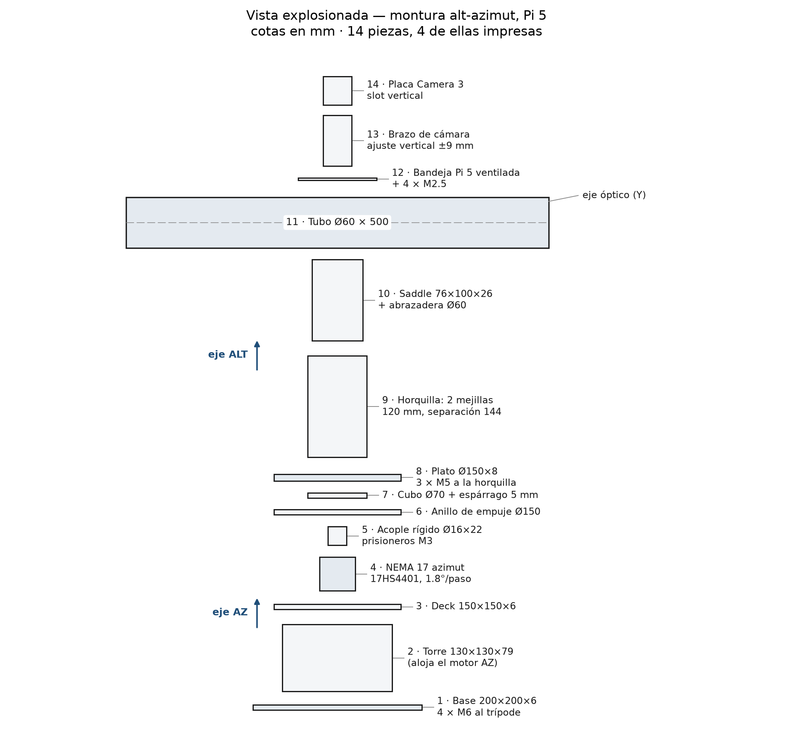

# Motivation

- Backyard astronomy has been industrialised: cameras, mounts and software are commodity parts.
- What is *not* democratised is autonomy — the instrument cannot find, verify and correct its own target.
- A \$300 telescope still needs a laptop to plate-solve, so perception lives off the mount and the mount stays open-loop.
- Inference has become cheap: INT8 quantization and 13 TOPS accelerators now fit on a Raspberry Pi HAT.
- The open question is whether that cheap inference actually makes the instrument point better.

# Problem

- Plate solving recovers pointing, scale and orientation by matching detected stars to a catalogue.
- Astrometry.net is robust and blind, but it is heavy by embedded standards and runs after the exposure on a host.
- The control loop is therefore split: perception on a laptop, actuation on the mount, a human in between.
- For a field instrument this is a dependency, not a convenience: no laptop, no pointing.
- A solver error of half a degree puts the target outside the field of view.

# Gap

- Edge-AI benchmarks report object detection and classification: a small IoU change is tolerable.
- Astronomical pointing is a regression problem with a physical interpretation — pixels become arcminutes.
- No study reports how quantization error propagates to *pointing error*.
- The instrumentation literature models pointing but treats computation as free.
- Nobody has compared CPU, accelerator and cloud for the same astronomical workload, on the same optics and mechanics.

# Contribution

1. **Reference architecture** — perception, decision and actuation co-located on a Pi 5, with an explicit degraded mode that works offline.
2. **Comparative study** — CPU vs Hailo-8L vs AWS Lambda on one quantized solver, reported as pointing error, latency, energy per session and cost per thousand inferences.
3. **Public dataset** — night-sky frames with independent astrometric solutions and the raw logs of all episodes.

The instrument is specified completely enough to be rebuilt from a bill of materials and a software manifest.

# Architecture

- **Compute:** Raspberry Pi 5, 8 GB — PCIe lane for the accelerator HAT, two MIPI camera ports.
- **Sensor:** Camera Module 3 on CSI, 2304 × 1296, native libcamera.
- **Actuation:** two NEMA 17 steppers, one per axis, A4988 carriers at 1/16 microstepping.
- **Optics:** 50 mm guidescope, 200 mm focal length, ~ 6.9 arcsec/pixel.
- **Fast loop:** 200 Hz step pulses, rate control and backlash compensation.
- **Slow loop:** capture → solve → residual → update model and setpoint. This is the loop we instrument.
- The cloud is an optional substrate, never a dependency.

# Hardware

::: {.columns}
::: {.column width="58%"}
- 2020 aluminium frame where a member spans more than 100 mm: 0.12 mm deflection over 200 mm, 3.1 arcmin.
- Printed PETG only in short, deep brackets — a 200 mm printed cantilever contributes 63 arcmin and is unusable.
- Both axes use the same 17HS4401 motor: azimuth is vertical and carries no gravity torque.
- Altitude is balanced: the tube centroid sits on the axis and a ~150 g counterweight recovers ~15 mm of offset.
- Bill of materials: \$168 in parts to acquire, \$238 with the Hailo-8L; \$278 / \$348 including hardware already owned.
:::
::: {.column width="42%"}
{width=100%}
:::
:::

# AI Model

- Two-stage solver: learned star detection, then deterministic geometric matching.
- Stage 1: quantized CNN predicts star probability and a distance transform; sub-pixel centroids by least squares.
- Stage 2: centroids matched against a catalogue index, attitude refined by least squares.
- Only stage 1 is learned — the geometry is identical in all three conditions, which isolates the substrate.
- Backbones: MobileNetV3-Small (primary) and a distilled transformer (tests NPU operator coverage).
- Training: synthetic fields from Gaia DR3 with instrument PSF and real sensor noise, fine-tuned on real frames.
- Quantization: post-training static INT8, calibrated to minimise the 95th percentile of angular error — not classification accuracy.

# Error Model

::: {.columns}
::: {.column width="60%"}
- **Periodic error** from the belt/worm reduction: one Fourier series per revolution, three harmonics retained.
- **Flexure** as a function of altitude: low-order polynomial fitted on a pointing grid.
- **Refraction** computed from pressure and temperature, applied feed-forward before the loop closes.
- **Backlash and stiction:** directional approach plus a measured hysteresis bound.
- The composite model is fitted once per instrument in a one-hour session and stored as a small coefficient set.
- Budget: 10 arcmin total. A 1/16 step costs 6.75 arcmin, and the ±5 % motor step error costs ±5.4 arcmin on its own.
:::
::: {.column width="40%"}
{width=100%}
:::
:::

# Control Loop

- **PID** on the pointing residual: anti-windup integral, filtered derivative, tuned by relay autotuning.
- **Linear MPC** with a ten-step horizon, using the error model as predictor and stepper rate limits as constraints.
- MPC solves in under a millisecond on the Pi 5 CPU, so it does not perturb the inference comparison.
- Controller is a blocking factor, not a research question: if one dominates, it is adopted for the final configuration.
- If the controller interacts with latency, that interaction is itself a reported finding.
- The slow loop tolerates hundreds of milliseconds — a slew and an exposure already take seconds.

# 3 Inference Architectures

| | E1 CPU | E2 Hailo-8L | E3 Cloud |
|:---|:---|:---|:---|
| Substrate | 4× Cortex-A76 | 13 TOPS NPU | AWS Lambda |
| Runtime | ONNX Runtime + XNNPACK | HailoRT | ONNX Runtime |
| Artifact | INT8 ONNX | INT8 HEF | INT8 ONNX |
| Network | No | No | Yes |
| Marginal cost | ~0 | ~0 | Billed per ms |
| Failure mode | Slow | Operator fallback | No connectivity |

Optics, mechanics, firmware, weights and control law are identical across the three conditions.

# Experimental Design

- **H1:** the Hailo-8L cuts median solve latency by at least 10× versus the Pi 5 CPU.
- **H2:** the pointing-error reduction is smaller than the latency reduction suggests, because error is optics- and mechanics-dominated.
- **H3:** at 50 solves per session and 8 sessions per month, cloud is cheaper per thousand inferences than the accelerator over 24 months.
- 3 substrates × 30 episodes = 90 episodes; targets fixed across conditions, order randomised, 15-minute thermal soak per block.
- Controller sub-study: 10 episodes per substrate per controller.
- Metrics: pointing error (arcmin RMS), latency p50/p95, Wh per session, USD per 1000 inferences.
- Baseline: a commercial GoTo mount in the \$500–800 class, same targets, same sky, same verification solve.

# Expected Results

- Large latency reduction from the accelerator; small accuracy gain.
- Cloud competitive on latency at a domestic link, not at a field site.
- Cloud cheaper at amateur utilisation; accelerator cheaper at observatory utilisation — the crossover is the useful number.
- A reproducible reference design, a public dataset, and the first head-to-head evidence on when an accelerator is worth its cost in a scientific instrument.
- Two manuscripts: *IEEE TIM* (instrument and measurement) and *IEEE IoT Journal* (edge–cloud allocation).
- The analysis pipeline is pre-registered and exercised on synthetic data before any hardware data exist.

# Timeline

| Month | Milestone | Deliverable |
|:---|:---|:---|
| 1 | Mechanical assembly, drive tuning, camera bring-up | Working mount; error coefficients |
| 2 | Dataset v1, backbone training, baseline solver | Checkpoints; solver benchmark |
| 3 | INT8 quantization, E1 integration, closed-loop PID | CPU-only pointing at target accuracy |
| 4 | HEF compilation, operator audit, E2; cloud function E3 | Three runnable substrates |
| 5 | Full campaign: 90 episodes + controller sub-study | Complete dataset and logs |
| 6 | Analysis, dataset release, manuscript submission | Public dataset; two manuscripts |

Critical path: month 3. Fallback if quantization degrades pointing: mixed precision on the first and last layers, reported explicitly.

# References

\begin{footnotesize}
\begin{itemize}
\item D. Lang et al., "Astrometry.net: Blind astrometric calibration of arbitrary astronomical images," \emph{AJ}, 139(5), 2010.
\item P. Bharat Chandra et al., "Low-cost Raspberry Pi star sensor for small satellites," \emph{JATIS}, 8(3), 2022.
\item H. Zhao et al., "Real-time CNN-based star detection and centroiding for CubeSat star trackers," arXiv:2404.19108, 2024.
\item L. Mu, Z. Zhang, Z. Li, "Weather-aware hybrid pointing model with ML residual correction," \emph{RAA}, 2026.
\item Z. Zhang et al., "DVFO: Learning-based DVFS for energy-efficient edge-cloud collaborative inference," arXiv:2306.01811, 2023.
\item S. Zhuo et al., "An empirical study of low precision quantization for TinyML," arXiv:2203.05492, 2022.
\item K. Podbucki, B. Szalwach, "Cost-effective edge AI: Hailo-8 powered Raspberry Pi vs. Jetson AGX Orin," \emph{Electronics}, 15(17), 2026.
\end{itemize}
\end{footnotesize}

Full reference list in the proposal.
